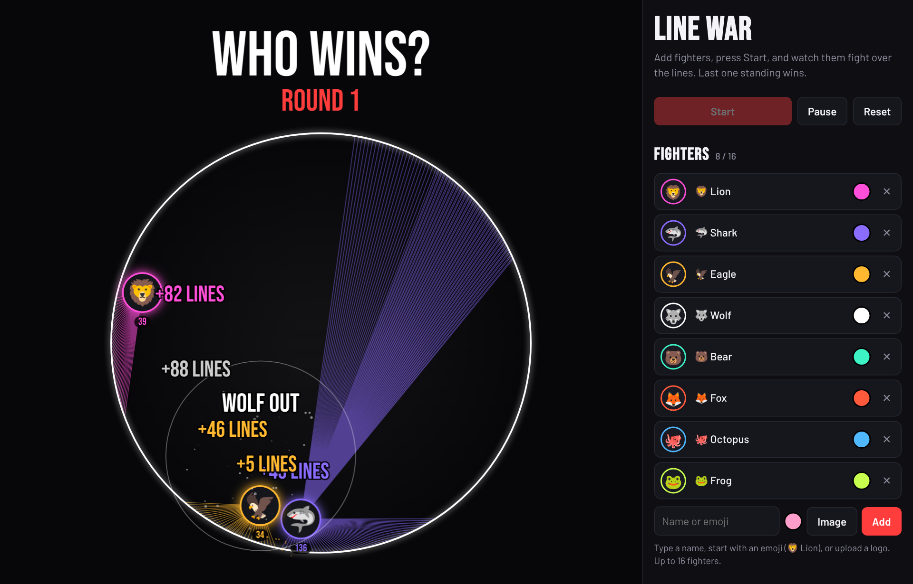

# Line War

A browser auto-battler. Add fighters, press Start, and watch them grab lines from the arena wall and cut each other's. Last one standing wins.

**[Play it here](https://williankeller.github.io/line-war/)**



## How it works

1. Fighters bounce around a circular arena at a constant speed.
2. When a fighter touches the wall it grips it and slides along the ring. Every degree it slides adds one line anchored to the wall. Grazing hits slide longer and earn more lines.
3. A rival whose body crosses a line cuts it.
4. A fighter that loses its last line explodes.
5. After the sudden death timer, grips get shorter and everyone speeds up, so every match ends.

A fighter can be a name, a name that starts with an emoji (`🦁 Lion`), or an uploaded image or logo. Your roster and settings are saved in the browser.

## Settings

| Setting | What it does |
| --- | --- |
| Speed | How fast fighters move |
| Fighter size | Radius of each fighter |
| Line density | Lines gained per degree of wall slide |
| Wall grip time | How long a fighter slides along the wall |
| Sudden death after | Seconds before the match speeds up |
| Title / Subtitle | Text above the arena. `{round}` is replaced with the round number |

Press **Space** to start, pause or resume.

## Run it locally

There is no build step and no dependencies. The code uses ES modules, so it needs to be served over HTTP instead of opened as a file.

```sh
git clone https://github.com/williankeller/line-war.git
cd line-war
python3 -m http.server 8000
```

Then open http://localhost:8000. Any static server works, for example `npx serve`.

## Project structure

```
index.html          Page markup
css/style.css       All styles
js/main.js          Entry point, game loop and controls
js/config.js        Arena size, colors, defaults and limits
js/game.js          Match simulation: movement, grips, cutting, effects
js/renderer.js      Canvas drawing
js/audio.js         Sound effects made with the Web Audio API
js/fighters.js      Fighter model, saving and image uploads
js/storage.js       localStorage helpers
js/ui/              Roster, settings, scoreboard and avatar components
```

`game.js` has no DOM code. It reports what happens through event callbacks (`grip`, `cut`, `eliminate`, `end` and others), which `main.js` turns into sounds and UI updates. That makes it the place to start if you want to change the rules.

## Contributing

Bug reports, ideas and pull requests are welcome. See [CONTRIBUTING.md](CONTRIBUTING.md).

## License

[MIT](LICENSE)
